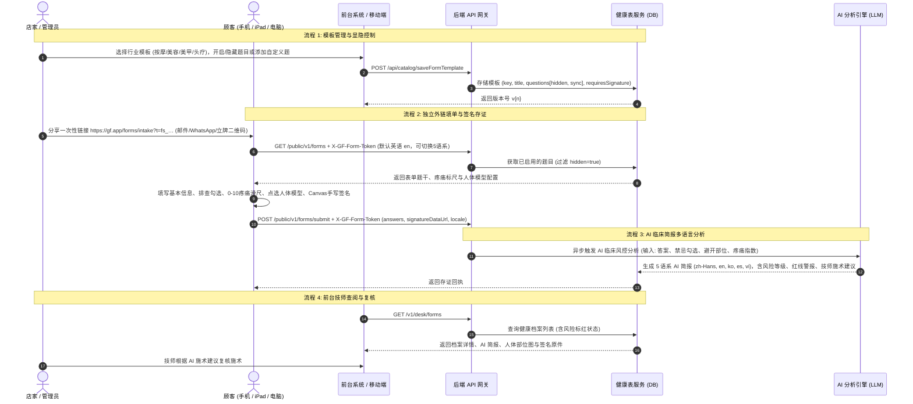

# 15 · 健康表系统：生成 / 存储 / 同步 / 分享 / AI 简报

> 门口那台 iPad 上的签名板是 2026-08-16 就做完的（`03` §Kiosk）。
> 这一份系统阐述**健康表的完整闭环链路**：老板怎么选择行业模板（按摩/美容/美甲/头疗）、控制每道题目显隐、添加新问题、生成独立填单外链（默认英文）、顾客如何进行 3 态人体模型与真实手写签名、后端如何生成 5 语系 AI 施术简报、以及前台与技师如何留痕查阅。
>
> 代码路径：
> - 前端管理后台：`apps/web/src/pages/HealthForms.tsx`
> - 顾客独立填单：`apps/web/src/pages/PublicHealthForm.tsx`
> - 交互式人体解剖图：`apps/web/src/components/forms/BodyMapSelector.tsx`
> - HTML5 真实手写签名板：`apps/web/src/components/forms/SignaturePad.tsx`
> - 模板与预设数据：`apps/web/src/features/forms/mockData.ts` & `presets.ts`
> - 多语言字典 (5 语系)：`apps/web/src/i18n/healthForms.ts`
> - 路由门禁与分发：`apps/web/src/App.tsx`（`/forms/:key` 公共路由）
> - 命令契约：`packages/contracts/src/commands/kiosk.ts`

---

## 0. 核心架构总览 (Executive Summary)

**健康表不仅是一张知情问卷，更是服务风控与出事时唯一的法律存证证据**（`00` §2）。

| 模块 | 核心能力 | 实现位置 | 状态 |
|---|---|---|---|
| **行业预设** | 4 大行业专属预设（**按摩优先**、美容、美甲、头疗） | `mockData.ts` & `HealthForms.tsx` | ✅ |
| **店主定制** | 题目**显示/隐藏自由切换**（无需硬删除）+ 自由添加新题 | `HealthForms.tsx` (`hidden: boolean`) | ✅ |
| **独立外链** | 免登录公开填单链接（`/forms/:key`），**顾客端默认英语 (`en`)** | `PublicHealthForm.tsx` & `App.tsx` | ✅ |
| **疼痛与人体模型** | 0-10 疼痛滑动标尺 + 正反面高精度 SVG 人体解剖 3 态交互 (Focus/Avoid) | `BodyMapSelector.tsx` | ✅ |
| **真实手写签名** | HTML5 Smooth Canvas 真实平滑笔触签名，导出 Base64 PNG 存证 | `SignaturePad.tsx` | ✅ |
| **✨ AI 施术简报** | 自动分析红线禁忌、避开部位与疼痛诉求，输出 **5 语系** 技师施术方案 | `mockData.ts` (`generateAiHealthSummary`) | ✅ |
| **分享渠道** | 专属直链、桌牌立牌二维码 (PDF/PNG)、WhatsApp、邮件 Email | `HealthForms.tsx` (`Share & Kiosk`) | ✅ |
| **短信发链接** | —— | ⛔ **故意不做短信**（美国 10DLC 运营商风控），见 §4.1 | ⛔ |

---

## 1. 四大行业模板库与题型设计 (Industry Presets)

### 1.1 预设排序与行业专注点
系统按店面需求优先级排列 4 大行业模板：

1. 💆 **推拿按摩 / 水疗 SPA (`massage_intake`)**【首位默认】：
   - **力度偏好**：轻柔 (Light) / 中等 (Medium) / 深层强劲 (Deep Tissue)。
   - **红线排查**：**心脏起搏器/金属植入物 (标红)**、深静脉血栓(DVT)/静脉曲张、未控高低血压、颈腰椎骨折/骨质疏松、**怀孕周数**。
   - **疼痛与人体模型**：0-10 疼痛滑尺、持续/间歇发作特征、正反面人体部位点选（🟢 重点加强 / 🔴 完全避开）。
   - **过敏与用药**：坚果精油、薰衣草、乳胶过敏史，近两年手术史。
2. 🌸 **美容 / 皮肤管理 / 轻医美 (`facial_skincare_intake`)**：
   - 肤质屏障（敏感泛红/玫瑰痤疮/干性/油痘）、近30天刷酸/光电激光/注射史、口服异维A酸(Accutane)及孕哺排查。
3. 💅 **美甲 / 美睫 / 足疗 (`nail_lash_intake`)**：
   - 灰指甲/甲真菌病、甲沟炎、UV光疗胶/丙烯酸/美睫黑胶过敏、近期眼部手术史、甲型修型偏好。
4. 💇 **头疗 / 日式头皮养护 / 美发 (`head_spa_intake`)**：
   - 头皮出油/头屑/敏感红肿/脱发、染烫发周期及染发剂 PPD 过敏史、冲水床仰卧颈椎耐受度及水压偏好。

### 1.2 题目显隐控制机制 (`hidden: boolean`)
- 店主在管理后台可针对任意预设题或自定义题点击 **【显示中 / 已隐藏】** 开关。
- 隐藏后的题目在后台卡片呈现琥珀色 `[🚫 已隐藏 (顾客端不展示)]`。
- **渲染规则**：公共填单页 `PublicHealthForm.tsx` 与接口自动执行 `questions.filter(q => !q.hidden)`，只向顾客呈现开启的题目。

---

## 2. 交互式人体解剖模型 (Interactive Body Map)

`BodyMapSelector.tsx` 提供了正反面双视角的高精度矢量 SVG 解剖模型：
- **覆盖部位**：头面部、咽喉颈部、胸部、腹部、骨盆、双肩双臂手腕、大腿前侧、小腿膝盖、后脑勺、后颈、上背肩胛骨、下背腰椎、臀部、大腿后侧腘绳肌、小腿腓肠肌、足底足跟。
- **3 态轮转状态机 (3-State Cycling)**：
  - **点击 1 次**：🟢 标绿（`part-focus` 重点加强 / 疼痛酸痛区）
  - **点击 2 次**：🔴 标红（`part-avoid` 需完全避开部位）
  - **点击 3 次**：⚪ 清除重置恢复默认
- **三端联动**：
  1. 顾客填单端：直观在手机/平板上点选。
  2. 档案详情抽屉：只读呈现顾客标记的热力图。
  3. AI 分析引擎：自动提取 `avoid` 部位生成安全风控策略。

---

## 3. ✨ AI 临床施术简报与 5 语系自适应引擎 (AI Summary Engine)

### 3.1 触发与分析维度
当顾客提交健康表或店主点击「✨ AI 重新生成简报」时，AI 引擎综合以下输入：
- 禁忌症与红线勾选（起搏器、血栓、孕期、高血压）
- 0-10 疼痛等级评分与发作频率
- 人体模型标记的避开部位与重点部位
- 过敏源清单（精油、胶水、染发剂）

### 3.2 5 语系输出结构 (`HealthAiSummary`)
AI 引擎生成包含 `zh-Hans`, `en`, `ko`, `es`, `vi` 5 语系的结构化数据：

```typescript
export interface HealthAiSummary {
  riskLevel: 'low' | 'moderate' | 'high';
  headline: Record<string, string>;          // 一句话核心诊断
  keyAlerts: Record<string, string[]>;       // 红线安全警报列表
  avoidAreasList: Record<string, string[]>;  // 需避开部位列表
  focusNotes: Record<string, string>;        // 重点诉求与痛感分析
  technicianAdvice: Record<string, string>;  // 💡 主理技师施术核心方案与注意事项
}
```

### 3.3 技师端使用体验
前台与主理技师打开顾客档案时，可在简报右上角**自由切换语言**，即使技师母语为西班牙语或韩语，也能即时以母语阅读顾客的身体禁忌与施术建议。

---

## 4. 独立外链与全链路时序图 (Full Sequence Flow)



### 4.1 ⚠️ 为什么故意不做短信分享 (No SMS Policy)
用平台号发一条带网页短链接的短信，在美国电信运营商（10DLC 通道）眼里与钓鱼欺诈短信特征高度重合。一旦被 T-Mobile / AT&T 封禁通道，受影响的是整套系统的预约确认与验证码。因此到店前分享仅走：**专属直链**、**桌面立牌二维码**、**WhatsApp**、**邮件 Email**。

---

## 5. 后端数据库 Schema 与 API 规范 (Database & API Contracts)

### 5.1 数据库建表 (PostgreSQL)

```sql
-- 1. 健康表模板主表
CREATE TABLE form_templates (
    id UUID PRIMARY KEY DEFAULT gen_random_uuid(),
    org_id UUID NOT NULL,
    key VARCHAR(60) NOT NULL, -- 如 'massage_intake', 'nail_lash_intake'
    title JSONB NOT NULL,     -- {"en": "...", "zh-Hans": "..."}
    category VARCHAR(30) NOT NULL, -- 'massage', 'facial', 'nail', 'hair'
    version INT NOT NULL DEFAULT 1,
    is_active BOOLEAN NOT NULL DEFAULT TRUE,
    requires_signature BOOLEAN NOT NULL DEFAULT TRUE,
    valid_days INT DEFAULT 365, -- 有效天数，NULL为永久
    service_ids UUID[] DEFAULT '{}',
    created_at TIMESTAMPTZ DEFAULT NOW(),
    updated_at TIMESTAMPTZ DEFAULT NOW(),
    UNIQUE(org_id, key, version)
);

-- 2. 模板题目表
CREATE TABLE form_questions (
    id VARCHAR(60) PRIMARY KEY, -- 如 'q_pressure_pref'
    template_id UUID NOT NULL REFERENCES form_templates(id) ON DELETE CASCADE,
    sort_order INT NOT NULL DEFAULT 0,
    type VARCHAR(20) NOT NULL, -- 'bool', 'text', 'choice', 'multi'
    label JSONB NOT NULL,      -- 多语言题干
    options JSONB,             -- 选项数组 [{"value": "opt_1", "label": {...}}]
    required BOOLEAN NOT NULL DEFAULT FALSE,
    hidden BOOLEAN NOT NULL DEFAULT FALSE, -- 🌟 店主是否隐藏该题
    sync_field VARCHAR(30)     -- 'health_flag', 'avoid_areas'
);

-- 3. 客户提交的健康表记录主表
CREATE TABLE form_submissions (
    id VARCHAR(40) PRIMARY KEY, -- 如 'SUB-892104'
    org_id UUID NOT NULL,
    template_id UUID NOT NULL REFERENCES form_templates(id),
    template_key VARCHAR(60) NOT NULL,
    template_version INT NOT NULL,
    customer_id UUID,          -- 可选关联会员档案
    customer_name VARCHAR(120) NOT NULL,
    customer_phone VARCHAR(40) NOT NULL,
    status VARCHAR(20) NOT NULL DEFAULT 'valid', -- 'valid', 'flagged', 'expired'
    has_health_flag BOOLEAN NOT NULL DEFAULT FALSE,
    avoid_areas TEXT[] DEFAULT '{}',
    answers JSONB NOT NULL,    -- 客户作答详情 (包含基础信息、疼痛评分、勾选题)
    signature_url TEXT,        -- S3/OSS 存储的手写签名图片 URL
    locale VARCHAR(10) NOT NULL DEFAULT 'en', -- 顾客填写时的语言 (默认 en)
    source VARCHAR(20) NOT NULL DEFAULT 'link', -- 'link', 'kiosk', 'desk'
    ai_summary JSONB,          -- 🌟 AI 5 语系临床简报数据
    submitted_at TIMESTAMPTZ DEFAULT NOW(),
    expires_at TIMESTAMPTZ
);
```

### 5.2 核心 API 接口清单
1. `GET /public/v1/forms`：用 `X-GF-Form-Token` 一次性令牌免登录获取被邀请填写的模板，过滤 `hidden=true` 的题目，支持 `?locale=en`（默认英语）。
2. `POST /public/v1/forms/submit`：携带同一令牌提交答卷与 Base64 手写签名；当前版本按门店固定业态只分享一份对应模板，提交前由顾客二次确认，提交成功后令牌立即失效并返回存证回执编号。
3. 预约关联分享会把 `appointment_id` 与真实客户一并写入签署记录；完成后系统向本店前台广播应用内通知，通知可直接打开预约详情。
4. 预约详情自动列出该预约已完成的健康表。员工明确点击后才解密内容并写访问审计，同时按当前后台语言生成 AI 健康与施术摘要。
3. `POST /v1/commands/catalog.saveFormTemplate`：店主保存/发布模板（含题目增改与 `hidden` 显隐切换）。
4. `GET /v1/desk/forms`：前台查询模板、分享状态与归档记录；`GET /v1/desk/forms/submissions/:id?reason=service_prep` 按权限解密内容并记录访问审计。

---

## 6. 测试与验证基准 (Testing Baseline)

- **前端 TypeScript 静态检查**：`npm --prefix apps/web run typecheck` (0 errors)。
- **单元与多语言测试**：`npm --prefix apps/web run test` (11 test suites, 64 tests 100% passed)。
- **模板契约验证**：`src/features/forms/presets.test.ts` 确保所有预设严格满足 `@gf/contracts` Zod 规范。
