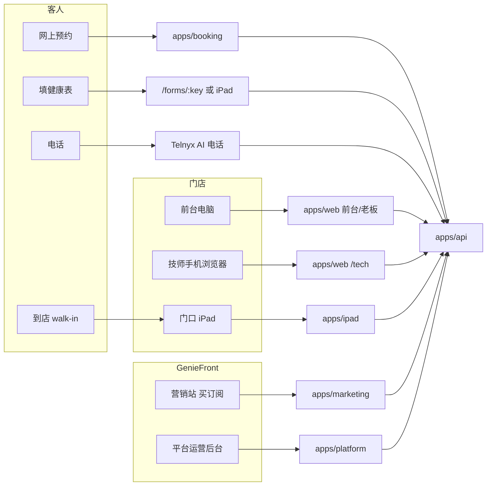
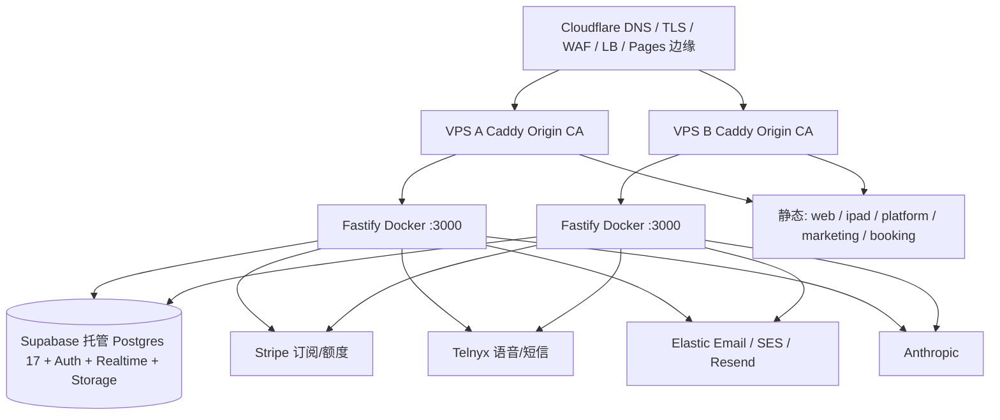
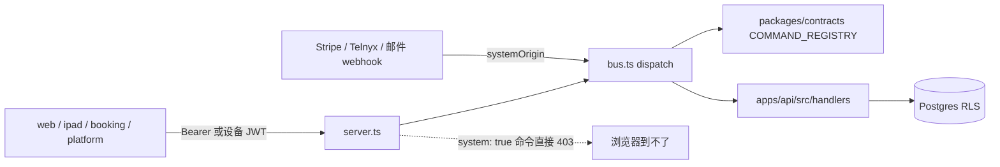

# 现行系统架构（2026-09-05）

> **这份是「现在仓库里实际长什么样」的地图。**
> 设计理念、容量模型和宪法仍读 [`01-ARCHITECTURE.md`](01-ARCHITECTURE.md) 与 [`03-ROADMAP.md`](03-ROADMAP.md)。
> `01` 里的仓库树（`apps/desk` / `staff` / `kiosk`、`packages/ui` / `i18n` / `sdk`）已经过时，不要按那张图找代码。
>
> 怎么测、测什么：[`qa/TEST-PLAYBOOK.md`](qa/TEST-PLAYBOOK.md)。

---

## 0. 一句话进度

GenieFront OS 是给美国亚裔服务业（nail / massage / foot spa / 头疗 / 美睫）用的 **AI 驱动门店操作系统**。店内收银是 **纯记录制**（现金/刷卡只记账，不接 POS）；GenieFront 自己的订阅和 AI 额度走 Stripe。

| 层 | 状态 | 说明 |
|---|---|---|
| Phase 0 地基 | ✅ | 命令总线、强制 RLS、审计、多店身份 |
| Phase 1a Desk 闭环 | ✅ | 轮牌、日程、开单、结账、小费、开店、断网只读 |
| Phase 1b 钱与班表 | ✅ | 提成、日结、现金小费、排班、报表 CSV |
| Phase 1c 技师端 | ✅ | 已并入 `apps/web` 的 `/tech`，不是独立 `apps/staff` |
| Phase 2 AI / 顾客侧 | 🚧 代码大半在，外部开关未全开 | 拍照开店、Yelp、Kiosk、健康表、托管预约、Stripe 计费、副驾都有代码。AI 电话卡 Telnyx 开户；SMS 卡 10DLC；预约自助管理页生产开关默认关 |
| 原生 iOS | ❌ 占位 | `apps/ios` 只有空 `package.json` |
| 上线判断 | **还不能把流量指到营销站** | 历史审计把「已计数缺陷」清零了，**不等于**功能/UI/多语言已验收。Playwright 没覆盖预约页和 iPad；E2E 只跑英文；平台后台几乎无单测 |

先前文档里「P0=0」的含义是：**某一次审计单上的票修完了**。不要读成「没有 bug、可以上线」。

---

## 1. 谁用什么端



| 用户 | 应用 | 入口（生产意图） | 本地默认 |
|---|---|---|---|
| 店主 / 前台 / 店长 | `apps/web` | desk 主机（Caddy `DESK_HOST`） | `:5177` |
| 技师 | 同一 `apps/web` 的 `/tech` | 同上，登录后按角色切门户 | `:5177/tech` |
| 门口自助 | `apps/ipad` | `KIOSK_HOST` | `pnpm dev:ipad` |
| 网上预约客人 | `apps/booking` | `book.geniefront.com/{slug}` | `:5176/{slug}` |
| 未登录填健康表 | `apps/web` `/forms/:key` | desk 主机公开路由 | `:5177/forms/:key` |
| 想买系统的老板 | `apps/marketing` | `MARKETING_HOST` / www | `:5180` |
| GenieFront 员工 | `apps/platform` | `PLATFORM_HOST` | `pnpm dev:platform` |
| 所有写操作 | `apps/api` | `API_HOST` + desk 同源 `/v1/*` | `:3000` |

`apps/ios` **不要测、不要部署、不要写进上线清单。**

---

## 2. 运行时拓扑



要点：

- 应用 **100% 无状态**。两台实例平级，会话在 Supabase Auth，实时扇出在 Supabase Realtime，不自管 Redis Pub/Sub。
- Caddy 只绑回环上的 API，对外 80/443。静态前端由部署脚本打进 `/srv/{web,kiosk,platform,marketing,booking}`。
- 开发：1 台 API + 各 Vite 开发服。Auth/Realtime/Storage 可连远程 Supabase 或 `scripts/local-supabase.sh`。
- **没有** BullMQ。进程内会起：outbox 清扫、次日预约提醒（`gf_appointments_due_for_reminder()`）、通话对账、评价同步（默认关）、保留策略。预约确认仍走 `email_outbox` 事务后直发。

---

## 3. Monorepo 真实结构

pnpm workspace + Turborepo。Node ≥ 22。

```
geniefront-os/
  apps/
    api/         Fastify 命令总线、查询、webhook、公开预约、kiosk 设备认证
    web/         统一 Web：前台 + 老板 + 技师 PWA
    ipad/        门口 Kiosk（配对、签到、walk-in、健康表）
    booking/     托管预约页 + 自助管理页
    marketing/   定价 / Stripe Checkout / 法律页
    platform/    内部运营（门店、工单、10DLC、建站工单、审计、测试收件箱）
    ios/         空壳，build/typecheck 都是 echo 占位
  packages/
    contracts/   Zod 命令、权限、错误码、locale —— 前后端唯一真源
    db/          Drizzle schema + sql/0001–0108 手写 RLS/触发器 + QA seed
    scheduling/  排期 / 营业日 / 空档（纯函数）
    rotation/    轮牌（纯函数，事件溯源）
    payroll/     提成、小费、礼品卡、额度（纯函数，钱用整数分）
    ai/          价目表视觉、副驾、经营摘要、健康表、翻译
    yelp/        Yelp 映射，刻意不过模型
    aws/         SES 签名
    brightdata/  抓取客户端
  deploy/        Docker + Caddy + 双 VPS 脚本
  e2e/           Playwright（web / platform / marketing / api，不含 booking/ipad）
  supabase/      本地 Auth 配置与邮件模板
  scripts/       env 守卫、i18n 关卡、QA、部署辅助
```

**不存在（但旧文档还在写）：** `apps/desk`、`apps/staff`、`apps/kiosk`、`packages/ui`、`packages/i18n`、`packages/sdk`。

技师端 = `apps/web/src/features/tech`。Kiosk = `apps/ipad`。

---

## 4. 写路径：命令总线

所有业务写入（租户能发起的）必须走：

```
UI → POST /v1/commands/:name
  → Zod 校验
  → 身份 / 权限
  → 幂等键
  → withTenant() SET LOCAL（RLS）
  → handlers/*
  → audit_log
```



两条硬规则：

1. **`system: true` 命令**（Stripe 已发生的事实、模型用量记账等）HTTP 入口直接拒绝；只有服务端带 `systemOrigin` 才能 `dispatch`。
2. **钱是整数分**，百分比用基点，AI 成本用毫分。禁止浮点算钱。

查询走 `GET /v1/desk/*`、`/v1/staff/*`、`/v1/me/*`、`/v1/public/*`、`/v1/platform/*`，不走命令总线。

命令按域分组（`packages/contracts/src/commands/`，约 150+ 条），包括：appointment、ticket、rotation、setup、staff、payroll、dayclose、shift、customer、giftcard、marketing、billing、kiosk、forms、phone、blueprint、notify、sms、email、storefront、support、reviews、profile、notifications、ai、analytics、yelp、google、resource。

---

## 5. 数据模型（按域，不是按表清单背）

手写 SQL：`packages/db/sql/0001` … `0108`。Drizzle 自动迁移只到 `drizzle/0010_*`，**新约束以 `sql/` 为准**。Schema 模块：

| 模块 | 管什么 |
|---|---|
| `tenancy` | org / location / 订阅状态 / slug |
| `identity` | users、membership、角色权限、PIN、设备 |
| `scheduling` | 预约、班表、营业时间、资源占用 |
| `tickets` | 工单、项目、支付、退款账本、组单 |
| `money` | 提成方案、earnings、现金进出 |
| `roster` / `attendance` | 技师档案、轮牌参与、打卡 |
| `kiosk` | 队列、健康表模板/提交/分享、设备令牌 |
| `billing` | 套餐、额度账本、Stripe id（系统所有） |
| `email` / `notify` / `notifications` | outbox、模板、退订、站内信 |
| `phone` | 线路、通话、call_drafts、转录 |
| `blueprint` | 价目表拍照草案 |
| `giftcard` / `marketing` | 礼品卡、次卡、优惠券、积分 |
| `storefront` | 建站工单（不是可视化编辑器） |
| `platform` | 运营账号、支持单、10DLC 内审 |
| `reviews` / `pairing` / `operations` / `settings` | 评价同步、设备配对、日结、门店设置 |

强制 RLS：应用用 `app_user`，靠 `SET LOCAL` 划 org/location/user。健康表答案 **AES-256-GCM 应用层加密**（`FORM_ENCRYPTION_KEY`），丢密钥 = 历史表永久解不开。

**营业日 ≠ 日历日。** 唯一判据 `businessDateOf`（`packages/scheduling`），前端入口 `useBusinessDay()`。Cutoff 默认 04:00，按门店 IANA 时区。不要用 `toISOString().slice(0,10)`。

---

## 6. 认证有四套，不要混

| 谁 | 机制 | 能做什么 |
|---|---|---|
| 店员浏览器 | Supabase Auth（邮箱密码 / Google / Magic Link） | 完整 desk / tech，权限来自 membership |
| 技师 PIN / 认领码 / 手机 OTP | 自签受限 JWT 或 `X-Staff-Token`（`staff_sessions`） | 打卡、技师工作台；不是老板后台 |
| 门口 iPad | 配对码 → 设备令牌 JWT | 几乎只有 `queue.join` + `form.submit` |
| 客人预约/改期 | 公开接口 + 管理令牌（fragment `#g/{token}`） | 建预约；管理页生产默认 `BOOKING_MANAGE_PAGE_ENABLED` 关闭 |
| 平台运营 | `platform_operators` 活跃行，**店主角色不够** | 看所有租户、处理支持单、10DLC 内审 |
| Stripe / Telnyx | 验签 webhook | 只能记外部已发生的事实 |

会话门禁在 `apps/web/src/App.tsx` 的 `SessionGate`：未登录 / 选店 / setup / 门户选择 / 纯技师，挂载的路由树都不一样。深链接绕不过服务端 `locations.status`。

---

## 7. `apps/web` 路由地图（前台要测的屏）

公开（可未登录）：

- `/login`、`/activate`、`/reset-password`
- `/forms/:key` 客人填表
- `/unsubscribe` 营销退订

Setup 未完成：只挂 `/setup`，其它后台路径重定向。

技师门户 `/tech`：

- `/tech/today` 今日单 + 打卡 + 开始/完成
- `/tech/summary` 收入
- `/tech/profile` 档案 / PIN / 语言

前台 / 老板（侧栏分组）：

| 组 | 路径 | 职责 |
|---|---|---|
| 核心前台 | `/dashboard` `/schedule` `/queue` `/checkout` `/tickets` | 今天、排班、候客、收银、订单 |
| 客户与运营 | `/customers` `/marketing` `/rotation` `/rooms` `/employee-performance` | CRM、礼品卡/次卡、轮牌、房间、员工 |
| 财务 | `/business-data` `/day-close` `/payouts` | 报表、打烊、提成 |
| AI 与配置 | `/calls` `/messages` `/communication-logs` `/storefront-builder` `/health-forms` | 电话、短信、日志、建站工单、健康表 |
| 帐号 | `/settings` `/support` `/profile` `/notifications` | 设置（含 billing）、支持、个人、站内信 |

`/settings` 需要 `settings.manage` 或 `staff.manage`。前台深链 billing 必须被拒，不能把整页打成致命错误。

高风险大文件：`pages/Queue.tsx`（签到/入座/完工/收银/walk-in 全在一个文件）、`pages/Settings.tsx`、`pages/Checkout.tsx`。

---

## 8. 其它前端

### `apps/booking`

- `/:slug` 选项目 → 技师 → 时间 → 资料 → 确认
- `/l/:slug` 与 `/l/:slug/g/:token` 自助改期/取消（令牌放 fragment，避免进访问日志）
- 英语客人为主，有 zh-Hans / ko / es / vi 词典
- Playwright **没有**把它列入 `webServer`

### `apps/ipad`

- `/pair` 配对 → `/` 主页 → `/check-in` `/walk-in` `/health-form` `/success`
- 3 分钟无操作回首页
- 五语言词典，独立于 web
- Playwright **未覆盖**

### `apps/marketing`

- `/` 定价（Essential $99 / Growth $199）
- `/signup/success` 必须服务端校验 Checkout session，不能只看 URL
- `/signup/cancel`、`/terms` `/privacy` `/sms`

### `apps/platform`

- `/` 总览、`/stores`、`/support`、`/10dlc`、`/website-requests`、`/audit`、`/email`、`/test-inbox`
- UI 基本是英文硬编码（`Loading…`），没有走 web 词典
- **没有** unit test 文件

---

## 9. 关键跨端业务流程

### 购买 → 开店

```
marketing 点 Essential/Growth
  → POST /v1/public/signup-checkout（metadata 必须符合 docs/11）
  → Stripe Hosted Checkout
  → webhook billing.syncSubscription（system）
  → 建 org/location（status=setup）
  → Magic Link /activate
  → claim
  → /setup 四步（资料、项目、员工、正式开店）
  → location.finishSetup 服务端再检查
  → desk
```

营销站 **不得**自己消费 Stripe webhook，只 API 消费。

### 一天的店

```
排班/轮牌就绪
  → 预约或 walk-in 进队列
  → 签到 → 入座/派技师 → 开始服务（开真实 ticket）
  → 加项/换房/备注
  → 完工 → 待收银
  → 结账（现金/刷卡记录、礼品卡、小费、不用找了）
  → 可选退款（只追加账本）
  → 打烊点钞封账
```

同一预约最多一张未作废工单、最多一条未离场队列记录。

### 网上预约

客人打开 `book.geniefront.com/{slug}` → 公开空档 → 建预约。确认短信/邮件里的管理链接受 `BOOKING_MANAGE_PAGE_ENABLED` 控制；生产未验证路由前应保持关闭。

### 健康表

模板六语言（数据层含 zh-Hant）。门口 iPad 或分享链接填写，答案加密，阅读留 `form_access_log`。回填客户档案只置「有禁忌」布尔和避开部位，不把病历明文铺到技师端。

---

## 10. 多语言现状（测的时候按这个预期，不要按理想文档）

| 表面 | 界面语言 | 缺口 |
|---|---|---|
| `apps/web` | zh-Hans / en / ko / es / vi | **zh-Hant 只做数据语言**，切换器没有繁体。`i18n-guard` 只扫 `pages/`+`components/` 的**中文**字面量，扫不到 `features/`、英文 placeholder、测试夹具 |
| `apps/booking` | 同上五语 | 独立词典，和 web 不是同一份 |
| `apps/ipad` | 同上五语 | 独立词典 |
| `apps/marketing` | 五语（`zhCN.ts` 等） | 独立词典 |
| `apps/platform` | 基本英文 | 运营工具，不是门店产品，但也不要假设已本地化 |
| 侧栏 | `t(key) \|\| '中文兜底'` | 缺词时韩/西/越会看到中文 |

大量输入框 placeholder 仍是英文（电话、金额、`e.g. Lavender oil allergy`）。换语言后这些不会变。这是真实缺口，不是「没测到的错觉」。

---

## 11. 外部依赖

| 服务 | 用途 | 上线卡点 |
|---|---|---|
| Supabase | Postgres / Auth / Realtime / Storage | 本地测试必须用隔离库 `DATABASE_TEST_TARGET=isolated` |
| Stripe | 月费 Essential/Growth、\$50 额度包、Portal、自动续充 | 套餐只有 essential/growth，价格 \$99/\$199 |
| Anthropic | 价目表视觉、副驾、经营摘要 | 每次模型调用前 `assertAiAdmission` |
| Telnyx | AI 电话 + 短信 | 电话卡开户/口音实测；短信卡 10DLC，产品决策是不阻塞核心开店 |
| Elastic Email / SES / Resend | `EMAIL_PROVIDER` | 2026-09-05 正在/已经迁 Elastic Email。营销群发一期关闭 |
| Yelp / Google / Bright Data | 店信息、评价 | 评价同步存在，不是每天必测路径 |
| Cloudflare Turnstile | 公开预约防刷 | 真预约必须真人过验证码 |

店内 POS、工资代发、银行划拨 **明确不做**。`sql/0060` 撤回了那套模型。

---

## 12. 测试基础设施（已有的，不是愿望）

| 命令 | 覆盖 |
|---|---|
| `pnpm lint:guards` | 宪法级：裸 `SET`、service_role 泄漏、业务表绕过 handlers、AI 门禁、常见假数据标记 |
| `pnpm typecheck` | 全 workspace |
| `pnpm test:unit` | 不碰数据库的纯函数/契约/web |
| `pnpm test` | 含 `@gf/api` + `@gf/db`，**必须**隔离测试库 |
| `pnpm test:e2e` | Playwright Chromium，自动起 api/web/platform/marketing |
| `pnpm qa:reset` / `qa:seed <scenario>` | Seed V2，密码统一 `GenieQa!2026` |
| `scripts/i18n-guard.mjs` | web 页面中文字面量 |

Playwright 现有 spec：`auth-setup`、`billing-permissions`、`business-day`、`multi-location`、`operations`、`platform-marketing-api`、`remaining-browser-qa`、`responsive`。默认 `locale: en-US`，`timezoneId: America/New_York`。

Seed 场景见 [`qa/SEED_SCENARIOS.md`](qa/SEED_SCENARIOS.md)。常用：`fresh_owner`、`growth_setup`、`empty_shop`、`busy_shop`、`day_close_ready`、`growth_active`、`past_due`、`multi_location_owner`、`tech_only`、`platform_operator`。

开发演示账号（`docs/16`，密码 `GenieDev!2026`）和 QA 账号不是同一套，不要混用。

---

## 13. 已知「未完成 / 不要当成已上线」

产品决策（不是 bug）：

- 店内支付纯记录，不收线上客单款
- 顾客账号不做，管理靠一次性链接
- SMS 独立成期
- 建站是工单不是编辑器
- 营销邮件一期关闭（界面 Coming soon）
- iOS 原生不做

代码在、开关未开或外部未就绪：

- `BOOKING_MANAGE_PAGE_ENABLED` 生产应关
- Telnyx 真电话口音实测
- 10DLC 承运商侧（内部 pending ≠ 承运商/TCR 已受理）
- 次日预约提醒：进程内 job 已有（`startReminderJob`），没有 BullMQ；要测的是它是否真的发出、时区对不对
- Elastic Email 一期文档写「已迁」，[`24-ELASTIC-EMAIL-PHASE1.md`](24-ELASTIC-EMAIL-PHASE1.md) 仍记生产 `EMAIL_PROVIDER` 可能还是 Resend —— 测邮件前先确认实际 provider
- 繁体界面
- Playwright 对 booking / ipad / `/tech` / 非英语 UI
- 技师端：拒单、技师加项目录、周/月收入、换班请假 —— `21` 交接里列为未做，不要当坏了
- 落单要素 `service_option_defs` 界面从未做（力度/甲型/色号）
- 通知事件 `staff_pending_confirm` / `staff_assigned` 以及确认信的一条备用路径，`27` 写明从未触发
- `EmployeePerformance` 仍 import `SampleDataNotice`，经营页若混入演示条带记缺陷

高风险未自动化 / 已知代码裂缝：

- Queue 全弹窗在真实门店节奏下的对错
- 退款 × 日结 × 提成 跨营业日
- 五语言切换后每个屏的截断、按钮溢出、词条回落到中文
- iPad 多客人 walk-in
- 公开预约 Turnstile + 时区
- 平台后台除已有 E2E 以外的操作
- Elastic Email 生产域名/抑制列表/退订
- **`POST /v1/desk/tickets/:id/send-receipt` 仍 dispatch 已删除的 `ticket.sendReceipt`**（2026-09-01 起产品只打印）。UI 若还有「补发电子小票」就是死按钮
- AI 电话工具含 `reschedule_appointment` / `cancel_appointment`，受门店 `saveAiChangePolicy` 闸门约束，不是「永远只能建单」
