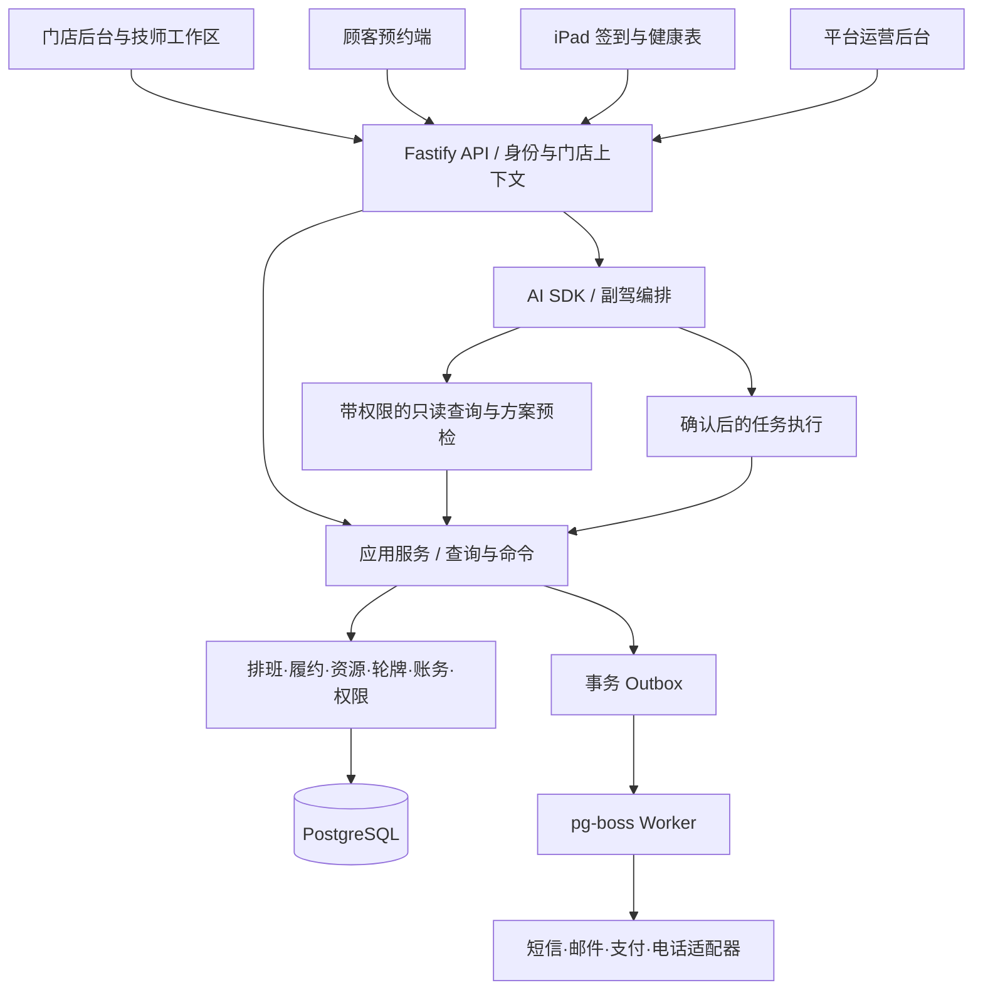

# GenieFront V2 重构计划、架构与技术栈

日期：2026-09-09。状态：计划，尚未创建新工程、安装依赖或启动整库重构。

依据：[产品规格](2026-09-09-local-v2-product-spec.md)、[需求扫描](2026-09-09-product-requirements-discovery.md)、[外部复用目录](../research/2026-09-09-open-source-reuse-catalog.md)。本计划记录用户最新决定，优先于此前关于全新视觉和替换日历的候选建议。

## 1. 目标与明确决定

- 现有产品的 UI 风格作为视觉基线：浅色背景、青绿色主色、卡片、抽屉和当前信息密度。通过一致性、交互和缺陷修复提升成品质量。
- 自定义 Kanban 和日程是产品资产。保留有价值的交互及显示方式，拆解内部实现，不默认替换成通用看板或日历组件。
- 七行业、前台/技师、顾客预约、iPad、平台运营均在完整目标内。通过行业配置共享业务模型，不复制七套系统。
- 建站保持现有人工代办：客户提交需求、平台经营者制作交付，保留工单、修改意见、预览与上线申请；不做自助建站器。
- 新工程在独立目录、端口和数据库中运行。先实现可比较的本地版本，达到替换标准后再安排历史数据迁移与切换。
- 通用能力优先采用外部开源；业务规则和经过验证的现有资产继续复用。每项替换要说明具体收益。
- HeroUI Pro 使用用户指定的 CollectUI 代理，安装、MCP、Skills、凭据与 CSS 约定见 [HeroUI Pro 代理接入](2026-09-09-heroui-pro-collectui-integration.md)。Pro 是商业组件来源，与 MIT 开源库分别记录。

## 2. 现有资产如何处理

| 资产 | 保留的价值 | 重构重点 |
| --- | --- | --- |
| `apps/web/src/index.css` 与 UI 组件 | 当前配色、圆角、层次、已有语义层级 | 提取统一 tokens；清理相互覆盖的样式、重复变体和散落的 z-index |
| `pages/queue/KanbanBoard.tsx` | 五列营业流转、客人卡片、逐项人位/时段/金额、单个主操作、触屏点击路径 | 展示组件与命令解耦；操作粒度明确；错误恢复、焦点、长内容和窄屏验证 |
| `pages/Schedule.tsx` 与 `features/schedule` | 技师列、不同视图、日期搜索、动态时间轴、拖动预览和改期确认 | 拆出布局算法、数据获取、操作控制器、事件卡片；修正时区、跨日、滚动和重叠问题 |
| `contracts`、命令总线 | 统一命令语义、权限、幂等与审计 | 清晰划分输入、应用服务与领域模型，统一错误契约 |
| `scheduling`、`rotation`、`payroll` | 排班、轮牌、金额分配和历史故障案例 | 以可重复输入核对后迁移，分离规则与数据库访问 |
| Copilot 任务执行服务 | 方案版本、预检、确认、防重复执行、任务记录 | 保留业务语义；模型通信与聊天组件接入 AI SDK/assistant-ui |
| 外部供应商集成 | 已建立的电话、支付、邮件与短信接口 | 封装 adapter，支持本地假服务与真实测试模式切换 |

本轮只读代码确认了上述结构，尚未对全部 UI 交互重新实测。旧源码注释不作为已修复或已验收的证据。迁移前建立相同数据下的截图和行为对照。

## 3. 大致架构：模块化单体

一套业务 API 与一个 worker 入口，共享领域服务、数据库和契约。各前端按用户与访问边界分开，业务规则保持唯一来源。



图中的“确认后的任务执行”包含前端确认与服务端方案版本核对，不表示模型直接确认自己提出的动作。

### 业务模块

| 模块 | 职责 |
| --- | --- |
| 身份与租户 | 门店、员工身份、角色、权限、切店、设备配对 |
| 目录与店规 | 服务、组合套餐、加项、价格、时长、技能、营业时间、行业预设 |
| 预约与排班 | 客户、预约、班表、资源计划占用、改期、取消、时区 |
| 营业履约 | 到店、候客、派单、逐项开始/完成、加钟、换人位 |
| 资源与轮牌 | 实际占用、多人位置、清洁、轮牌资格及消耗记录 |
| 金额与结算 | 收款、混合支付、找零、小费、退款、提成、发放、日结 |
| 客户与表单 | 客户档案、健康表模板版本、签名、访问记录 |
| 增长与订阅 | 礼品卡、次卡、优惠券、积分、平台订阅、AI/语音额度 |
| AI 与通信 | 查询工具、方案任务、通知、电话入口、供应商事件 |
| 平台运营 | 开店、线路配置、支持工单、人工建站工单与审计 |

### 数据与执行约束

- 普通点击、Kanban 拖放、日程改期、公开预约、电话与 AI 最终进入同一组应用命令；不同入口具有各自的身份与权限约束。
- 前端保留布局算法、筛选与拖动预览；金额、资源冲突、状态是否允许改变由服务端决定。共享纯函数可用于预览，但提交时重新核对。
- 业务事实与 Outbox 在同一事务写入，worker 处理通知与外部任务。队列重试不等于外部副作用只执行一次，使用稳定幂等键及供应商事件去重。
- 服务状态、付款状态、资源清洁状态独立存储；Kanban 列与主动作由事实推导。不能把拖入某列当作付款完成。
- 实时消息负责提示缓存失效/新版本；断线或休眠恢复后重新读取服务端快照。首版本地运行不等于支持离线收银，离线界面明确标为只读。
- 消息历史与任务记录分开：聊天重试、编辑或重新生成不能隐式重做已执行命令。任务版本、状态和审计存 PostgreSQL。

## 4. 技术栈决定

不在计划阶段盲写最新版本号。工程初始化锁定一组兼容版本和 lockfile，验证 React/UI、AI SDK/assistant-ui、Zod/Fastify、Node/pg-boss 的兼容性。

| 层 | 默认选择 | 理由与边界 |
| --- | --- | --- |
| 语言与工程 | TypeScript、Node.js、pnpm workspace、Turborepo | 延续现有技术与多端共享方式 |
| Web | React、Vite、React Router | 延续现有应用结构；无须因 AI SDK 迁移到 Next.js |
| 设计系统 | `@gf/ui` + Tailwind CSS + HeroUI / HeroUI React Pro | 以当前视觉为基线；Pro 按 CollectUI 代理方案接入，组件、状态和层级收敛到统一入口 |
| shadcn | 组件源码/组合方式的备选来源 | 优先查询 HeroUI Pro；个别组件确有收益时适配到 `@gf/ui`，不叠加 shadcn 全局主题，不维护两套同类组件 |
| 图标与动效 | Lucide、Motion | 延续；动效只用于状态反馈，提供减少动效模式 |
| 通用列表 | TanStack Query/Table，Virtual 按需 | 统一缓存、表格与大数据列表 |
| 表单 | React Hook Form + Zod | 统一输入、提交状态和错误呈现 |
| Kanban 与日程 | 迁移现有自定义实现，拆出 renderer/controller/layout | 保留产品特点；dnd-kit 只在拖放层需要时引入；不默认安装通用日历 |
| 日期与金额 | 门店时区工具、date-fns/rrule 按需；整数最小货币单位，decimal.js 按需 | 保留已验证的领域规则，统一时区、舍入与精度 |
| 报表与语言 | Recharts；react-i18next + 原有词条迁移 | 统一业务口径和语言字典，保留当前支持语言 |
| API 与契约 | Fastify + Zod 契约 + OpenAPI + Scalar | 明确输入/输出/错误；ts-rest 仅在适配验证证明能简化代码后加入 |
| 数据库 | PostgreSQL + Drizzle | 事务、约束、审计与迁移保持集中 |
| 认证/文件/实时 | 延续 Supabase Auth、Storage、Realtime 接入 | 单一认证体系；各端按权限订阅与访问，不同时增加 Better Auth |
| 后台任务 | pg-boss + worker + Outbox | 复用 PostgreSQL，不增加 Redis 依赖 |
| AI | Vercel AI SDK + assistant-ui primitives + 业务任务服务 | 通信/聊天复用框架；业务预检、确认、幂等保持服务端控制 |
| AI 调试 | promptfoo；Langfuse 按需要部署 | 从真实店务场景建立回归集；模型、超时、预算按场景配置 |
| 健康表 | JSON Forms + 自有 renderer；Signature Pad | 复用动态填写和签名采集；模板版本、存证和访问仍由业务实现 |
| 邮件 | React Email + 现有发送供应商 adapter | 模板复用；本地 Mailpit 接收 |
| 支付/电话/短信 | 现有供应商 adapter | 不在本次重构同时迁移供应商；生产动作与本地模拟清楚区分 |
| 运行诊断 | Fastify/Pino 结构化日志、requestId/taskId/operationKey | 首版可追踪接口、任务、通知与业务命令，日志按字段脱敏 |

HeroUI 官方支持基于 Tailwind/CSS 变量的主题控制；assistant-ui primitives 不固定视觉，因此可接入上述自有 UI。参见 [HeroUI 主题](https://heroui.com/en/docs/react/getting-started/theming)、[assistant-ui primitives](https://www.assistant-ui.com/docs/primitives)。

不进入首版默认栈：FullCalendar/React Big Calendar/Schedule-X、Temporal、Redis/BullMQ、Mastra/LangGraph、OpenFGA、独立 ERP、Puck/Payload、自助建站。Chatwoot/Metabase 等系统保留为后续有明确需求的独立接入候选。

## 5. 工程组织与本地运行

建议后续创建 `/Users/naiyouzhu/siteadmin/geniefront-v2`；本轮不创建。

```text
apps/
  desk/          门店后台；技师工作区按路由和权限进入
  booking/       顾客预约和管理链接
  kiosk/         iPad 签到与表单
  platform/      平台运营及人工建站工单
  marketing/     现有官网营销/开户入口的必要适配
  api/           HTTP、身份上下文、命令和查询入口
  worker/        异步任务入口，复用应用服务
packages/
  ui/            统一组件与 tokens
  contracts/     API/事件/命令结构及错误码
  domain/        按模块拆分的状态、金额、排班、轮牌纯规则
  application/   命令、查询、事务协调与接口定义
  db/            Schema、迁移、repository
  integrations/  支付、电话、短信、邮件 adapters
  ai/            模型通信、工具描述和副驾编排
  i18n/          共享词条
  testkit/       固定演示场景、接口模拟、验收数据
```

依赖方向：domain 不依赖 React、Fastify 或供应商 SDK；application 通过接口使用存储/外部服务；db/integrations 实现接口；api/worker 在入口组装。前端通过契约访问 API，不能直接改业务账务表。只有实际需要跨端共享的内容进入 packages，避免为每个文件造一个包。

本地基础运行集合：独立 Supabase 项目、API、worker、当前正在验收的前端、Mailpit。其余前端按需启动。端口先检查占用后固定配置；不要与旧库共享 Auth、Storage 或业务数据库。提供 setup/dev/seed/reset-test/verify 命令；数据重置仅允许专用测试环境。

原生 iOS workspace 当前为占位，原生应用不新增到本次目标；技师手机和 iPad 先覆盖现有 Web 工作区能力。

## 6. 分阶段计划与完成条件

各阶段按真实业务链路推进，接口与界面在每阶段接通，不将前后端分别堆到最后才联调。

| 阶段 | 交付物 | 完成条件 |
| --- | --- | --- |
| P0：基线与资产清单 | 现有 UI 截图/行为样例，bug 与不一致清单，GF-01–36 功能映射，迁移/重写/暂缓表 | Kanban、日程、收银、AI、设置的保留项与已知缺陷有证据；能区分代码注释和实际结果 |
| P1：工程与组件基础 | 独立本地环境、统一身份上下文、UI tokens/组件、共享契约、Storybook、演示数据 | 登录→门店→显示同一组真实本地数据；按钮/表单/弹层层级一致，旧环境不受影响 |
| P2：营业主流程 | 目录/员工/资源、预约→到店→派单→逐项服务；迁移 Kanban 与日程 | 同一客人的状态在两个视图一致；拖动改期、换人位、加钟、清洁和冲突失败均可操作与恢复 |
| P3：收银与员工收入 | 三种收款阶段、混合支付、退款、提成、小费、发放与日结 | 金额守恒、重复提交、已发放后退款可追溯；历史案例与旧版对照 |
| P4：其他端与经营能力 | 顾客预约、技师、iPad、健康表、权益、订阅、设置、平台工单 | 七行业按适用范围跑场景；权限/脱敏/切店/休眠恢复一致；人工建站工单保留 |
| P5：AI 与外部服务 | AI SDK/assistant-ui、通知 worker、电话/支付/短信 adapters | AI 查询→澄清/提案→修改→确认→执行→刷新恢复；通知失败与重试可追踪；真实供应商未验证项明确列出 |
| P6：全流程验收与本地候选版 | 缺陷收敛、截图对照、启动说明、演示账号、测试证据 | GF-01–36 / A01–18 可追踪；关键流程无阻断，用户能在本地完整试营业 |
| P7：替换准备 | 备份、保留标识的迁移映射、数量/金额校验、回退演练 | 本地体验被接受后另行执行；正式切换前有具体迁移结果与回退证据 |

P2 产生第一版可以动手对比的营业流程，P3 产生可核对账务的核心候选版；它们不代表全项目完成。最终目标仍包含后续阶段。

如果以后使用两个 Goal：后端 Goal 负责应用服务/契约/数据库/集成测试；前端 Goal 在契约可用后推进 UI，并承担联调修复与完整浏览器验收。两条 Goal 共享本计划、固定场景与缺陷清单，不各自重新发明业务规则。本轮只制定计划，不创建 Goal。

## 7. 开发和验收工具

| 工具 | 使用目的 |
| --- | --- |
| Codex（按用户选定的 Astra/high 配置） | 按模块阅读、实现、评审和修复；完成以交付与验收为准 |
| Git + 独立目录/分支 | 保存旧版、阶段检查点和可比较的改动；不自动合并/部署 |
| pnpm/Turborepo/TypeScript | 统一依赖、构建、类型检查与工作区任务 |
| Storybook | 当前视觉基线的组件状态目录：长文案、多语言、空白、错误、禁用、加载、成功 |
| hpsetup / hpmcp / HeroUI Pro Skills | 通过 CollectUI 安装 Pro、查询实际组件 API/CSS/tokens 并遵守使用模式；按代理接入文档配置，真实凭据不写入仓库 |
| Vitest + Testing Library | 领域规则、应用边界、必要的组件交互测试 |
| fast-check | 金额守恒、分配、轮牌和状态转换的组合输入验证 |
| Playwright | 端到端流程与截图对照，包含桌面、平板、手机和键盘/触屏路径 |
| MSW | 独立前端开发与接口异常模拟；真实验收仍连本地 API/数据库 |
| 独立 PostgreSQL 测试库 | 并发占用、事务、幂等、租户隔离与迁移测试 |
| promptfoo / 可选 Langfuse | AI 场景回归、工具调用结果、延迟与用量定位 |
| Mailpit + adapter fixtures | 本地邮件与供应商回调样例，明确模拟结果 |
| Scalar + 结构化日志 | 联调查询、错误定位和事件链追踪 |

测试针对真实风险和历史故障，不为每次简单样式调整新增镜像实现的测试。修复一次具体问题后，运行对应检查；只有发现新风险才扩大或重复检查范围。

## 8. 替换标准

- 看板和日程的核心信息、快捷操作、当前工作习惯得到保留；改善项有相同数据下的新旧截图和行为证据。
- 同一业务在不同页面、设备和 AI 入口产生相同结果，失败不会留下假成功或重复账务。
- 时间、金额、资源、权限、语言有可复现验收数据；旧缺陷不能仅因换目录而消失在清单中。
- 本地可启动、可恢复、可演示；模拟外部服务明确标示，生产供应商与历史迁移的未验证事项不宣称完成。
- 正式替换有备份、迁移对账及回退路径。没有达到这些条件时，只交付本地候选版。
